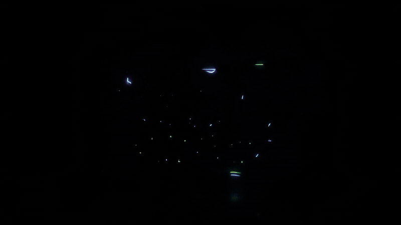

[Español](README.md) · **English**

<div align="center">
  <h1>DBZ BT4 Tag Team Recomp</h1>
  <p><strong>The Tenkaichi universe. Your team. One arena.</strong></p>
  
  <p>Simultaneous team battles · Online rooms · Proximity voice</p>
  <p><strong>Windows · BT4 B14 Rev2 profile · R16-rc1 preview</strong></p>
  <p><a href="#what-changes-from-the-original-bt3">Explore the mod</a> · <a href="#install-or-update">Installation</a> · <a href="docs/review/R16-rc1.md">Status and testing</a></p>
</div>

## The arena fills up. The battle changes.

**BT4 Tag Team Recomp** brings Budokai Tenkaichi into a shared battle: multiple
fighters, two teams, and the action unfolding at the same time. It combines the
content of the **BT4 B14 Rev2** profile with a native Windows adaptation based on
**Tenkaichi3Decomp**, adding its own Tag Team mode.

While you look for an opening, your allies are fighting too. Switching targets,
watching your teammates and coordinating become part of the fight. The spectacle
of Tenkaichi opens up to simultaneous battles of **up to 5 versus 5**, with seats
for human players and CPU fighters.

| Build your team | Share the battle | Make it yours |
| --- | --- | --- |
| Up to ten fighters in one arena, divided into two teams. | Room-code lobbies and proximity voice to coordinate during a match. | An adjustable Tag Team HUD and the PC port's video, audio and control settings. |

<p align="center">
  
  <br><em>A shared battlefield: allies on the left, opponents on the right, and radar to keep track of the action.</em>
</p>

## What changes from the original BT3

This comparison refers to **Budokai Tenkaichi 3 on PlayStation 2**. BT4 content,
PC port features and the Tag Team additions come together in this project.

| Aspect | Original BT3 (PS2) | BT4 Tag Team Recomp |
| --- | --- | --- |
| Team battles | One active fighter per side, switching between team members. | Multiple fighters active at once, up to 5 on each team. |
| Characters and content | The original game's roster and resources. | BT4 B14 Rev2 profile content, with resource-loading adaptations for the port. |
| Online play | No equivalent to this project's online room system. | Room-code lobbies and team selection to organize Tag Team matches. |
| Communication | No integrated proximity voice. | Integrated voice with attenuation based on the distance between fighters. |
| Battle information | Interface focused on the two active fighters. | Adjustable HUD with ally information, targets and radar for multiple combatants. |
| PC experience | Original release designed for a console. | Native Windows execution with resolution, display, audio and control settings. |

Native PC execution and its settings come from **Tenkaichi3Decomp**. The BT4
profile adaptation and Tag Team mode build on that work; port and content credits
are retained below.

<p align="center">
  
  <br><em>BT4's presentation with PC settings to adapt the display to your system.</em>
</p>

The screenshots show one configuration, not a performance guarantee for every
system. Support for up to ten fighters does not mean every combination of players,
characters and connections has been verified; see the preview's recorded tests
and limitations.

## Project status

The recorded preview is `BT4-v0.1.38.1-r16-rc1`. See the
[R16 review](docs/review/R16-rc1.md) for tested scenarios and remaining issues.
Download availability is listed on the [Releases page](https://github.com/NauTaro/BT4-Tag-Team-Recomp/releases).
A draft release is not a published download. The source checkout is not a playable installation.

## Install or update

The complete Windows launcher ZIP supports both a first installation from the
user's own BT4 B14 Rev2 ISO and an existing extracted installation. Existing
users copy the program files over their installation with the game closed.
The archive does not contain `bt3_settings.txt`, `gamedata` or `saves`, so those
are not replaced. A new ISO extraction is needed only for a first installation
or a different/incompatible game-data profile, not every code update.

See `port/release/PORTABLE_LAYOUT.json` for the runtime layout. Documentation
and corresponding source are separate from the game folder in the ZIP.

## Source and upstream

Base: [z3xox/Tenkaichi3Decomp](https://github.com/z3xox/Tenkaichi3Decomp),
tag `v0.1.38.1`, commit `11059a6d3e814cf36e6ca1f6307839f61c56f1cc`.
Upstream history is retained. This is an independent mod, not an official
upstream release. See [the original README](README_UPSTREAM.md),
[the upstream lock](UPSTREAM_LOCK.json), [port documentation](docs/port/README.md)
and [review build helpers](tools/review/README.md).

## Contributing and checks

See [CONTRIBUTING.md](CONTRIBUTING.md) for the repository map, build limitations
and bug-report guidance. Lightweight checks require Python 3.12 and no game data:

```sh
python -m unittest discover -s tools/review/tests -v
```

GitHub Actions runs these checks on Linux and Windows. They validate the portable
layout tool; they do not build the game or certify gameplay, voice or netplay.

## Credits and licensing

Original decompilation and PC port: Tenkaichi3Decomp contributors.
BT4 content belongs to its respective authors. Game data must be supplied
by the player. Retained licenses are [AGPL](LICENSE), [MIT](LICENSE-MIT)
and the third-party notices shipped with the runtime and voice libraries.

Artwork and icon retain their respective rights.

Screenshots and animation: [media sources and credits](docs/presentation/CREDITS.md).
