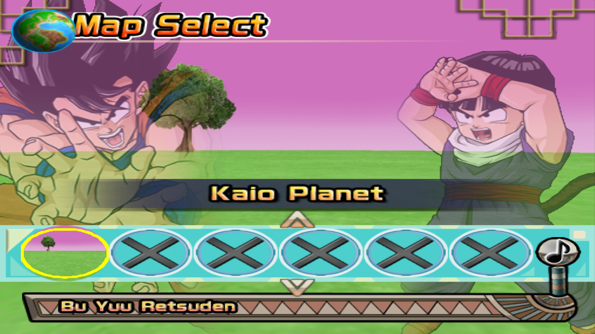

  <h1>DBZ BT4 Tag Team Decomp</h1>
  
A native Windows port of BT4 B14 Rev2 with simultaneous battles of up to five fighters per team.

  
  
<strong>BT4 B14 Rev2 · R26 RC1</strong>

  
<a href="#gameplay">Gameplay</a> · <a href="#installation">Installation</a> · <a href="#languages">Languages</a> · <a href="#support-and-contact">Support &amp; contact</a>

## Gameplay

Up to ten fighters share the arena in Tag Team, with human players and CPU
fighters on either team. Online rooms use a shareable code. During a match,
the HUD displays ally health, enemy targets and a radar.

Quick Match supports automatic nearby matching or a chosen region. Room codes
remain available for arranged matches.

Built-in proximity voice chat works across both teams. Volume decreases with
distance and fades to silence outside the hearing range.

During combat, open the pause menu and select **Hide HUD**, directly below
**Look at Skill List**. Select **Show HUD** to restore it. The Spanish labels
are **Ocultar HUD** and **Mostrar HUD**. This hides health bars, damage and
technique labels, radar, player names and battle overlays on your own screen.
The same control is available under **F1 → Video**, including modes without a
standard pause menu. Online opponents keep their own HUD setting.

The Windows runtime is based on
[Tenkaichi3Decomp](https://github.com/z3xox/Tenkaichi3Decomp), which compiles the
original game code for PC.

  
   <em>A 5v5 match with the Tag Team HUD.</em>

## Video and performance

Smooth motion defaults to 60 displayed pictures per second. Combat retains
the original 30-step simulation; online Tag Team runs that simulation at
114% speed. Extra pictures are rendered between steps, without changing
movement speed, hit timing or network inputs. F1 > Video offers an explicit
30-picture option and higher presentation rates. The renderer reduces extra
pictures when the graphics workload cannot fit the frame budget.

On supported systems with more than two logical CPU cores, rendering uses a
separate thread by default. OpenGL and smaller CPU configurations retain the
single-thread path. Resolution remains configurable; updating does not force
Tag Team to a particular scale.

## Installation

Download the [Windows package](https://github.com/NauTaro/DBZ-BT4-Tag-Team-Decomp/releases/tag/bt4-r26-rc1)
and extract the entire ZIP into the folder where you want to keep the game.
`Install.exe` and `Tenkaichi3Decomp.exe` must be in the same folder.

1. Open `Install.exe`.
2. Choose the installer language and the game language or languages.
3. Select a compatible Spanish or English **BT4 B14 Rev2 ISO** and complete setup.
4. Start the game with `Tenkaichi3Decomp.exe`.

### Updating an existing installation

Close the game, extract the new ZIP over your existing installation, and
replace the files when prompted. Keep `gamedata`, `saves`,
`bt3_settings.txt` and `online_name.txt`.

Updates reuse the installed game data. You do not need to extract the ISO
again.

## Languages

The installer interface is available in Spanish and English. Game language
selection covers both text and voices.

| Installation | Result |
| --- | --- |
| Spanish | Installs from the Spanish ISO and starts directly in Spanish. |
| English | Installs from the English ISO and starts directly in English. |
| Spanish and English | Installs the selected ISO and downloads the other language package from this repository. The game shows a language selector at startup. |

For a two-language installation, setup displays an **Installing language pack**
progress indicator. The repository is private: authorize a GitHub account
with read access when setup requests it. Existing installed language files
can be reused.

Spanish and English use the same supported BT4 gameplay profile for online
play. Compatibility checks use that profile rather than the displayed
revision label.

  

## Custom maps

Place a compatible `.unk` stage model in the `stages` folder beside the
executable. Add a PNG with the same filename stem to provide its thumbnail
and preview. Custom maps appear at the end of the offline map selector.

See the [custom stage guide](docs/port/adding_stages.md) for image limits,
display names and installation examples.

  

## Development

The [contribution guide](CONTRIBUTING.md) describes the source layout, build
tools and validation requirements. The [documentation index](docs/README.md)
links to runtime, customization and original game architecture references.

## Support and contact

Contributions support development:

  
   <a href="https://www.paypal.com/paypalme/NauTaro">PayPal: @NauTaro</a>

For questions or feedback:

- **Discord:** `@nautaro`
- **Email:** [mellamannau22@gmail.com](mailto:mellamannau22@gmail.com)

For bugs, use the [issue form](https://github.com/NauTaro/DBZ-BT4-Tag-Team-Decomp/issues/new/choose)
and include reproduction steps and the relevant log.

## Credits and licenses

The original decompilation and PC port are by the **Tenkaichi3Decomp
contributors**. This project is based on upstream `v0.1.38.9`; the exact
source revision is recorded in [UPSTREAM_LOCK.json](UPSTREAM_LOCK.json).
The [upstream README](README_UPSTREAM.md) is retained for attribution and
reference.

BT4 content, artwork and icons remain the property of their respective
authors. See the [presentation credits](docs/presentation/CREDITS.md),
[AGPL license](LICENSE), [MIT license](LICENSE-MIT) and third-party library
notices.
