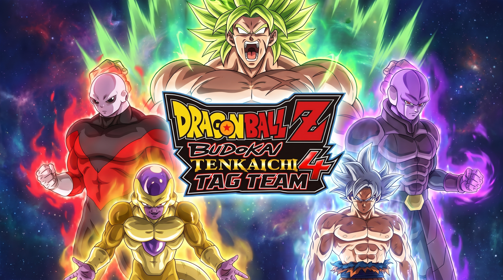
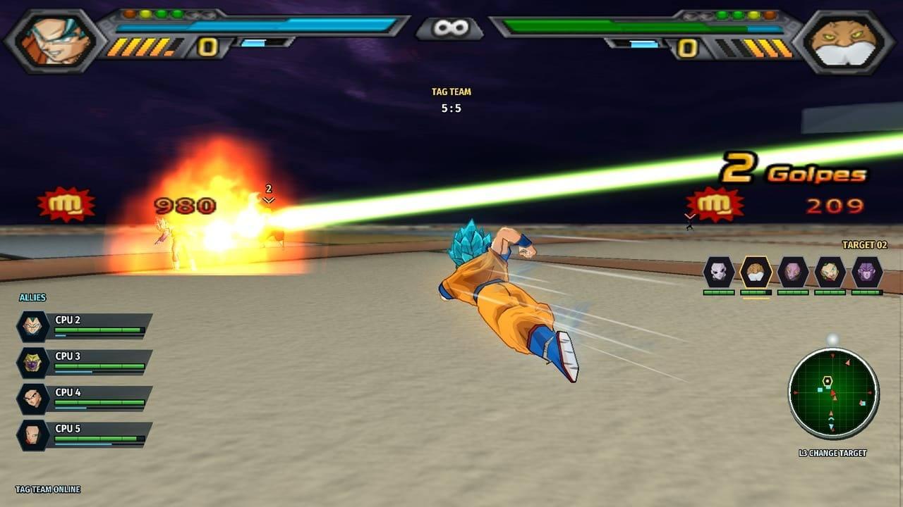
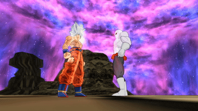
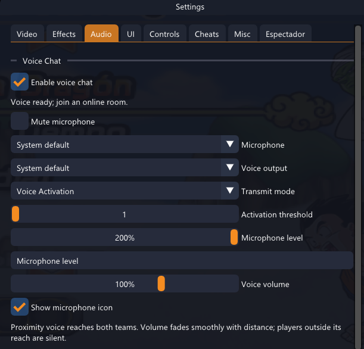
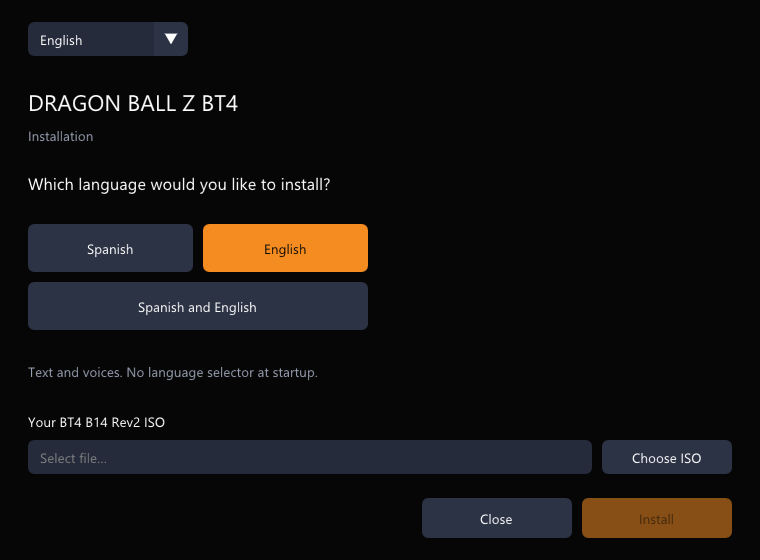

  
  <h1>BT4decomp</h1>
  
<strong>Budokai Tenkaichi 4 B14 Rev2. Native desktop runtime. Simultaneous team battles.</strong>

  
Online Tag Team, tournaments, spectator rooms and proximity voice, built on Tenkaichi3Decomp.

  

    
    
    
    
  

  
<strong><a href="https://github.com/NauTaro/DBZ-BT4-Tag-Team-Decomp/releases/latest">Download</a> &nbsp; · &nbsp; <a href="#installation">Install</a> &nbsp; · &nbsp; <a href="docs/README.md">Documentation</a> &nbsp; · &nbsp; <a href="https://github.com/NauTaro/DBZ-BT4-Tag-Team-Decomp/issues/new/choose">Report an issue</a></strong>

BT4decomp adapts **BT4 B14 Rev2** for Windows, Linux and Apple Silicon. It runs the game code natively rather than emulating a console. Installation requires your own compatible Spanish or English BT4 ISO; disc images and extracted game data are not distributed here.

## Fight together

| Mode | What it offers |
| --- | --- |
| **Tag Team** | Simultaneous battles with up to five fighter slots per team, human players and CPU fighters, room codes and individual targeting. |
| **1 vs 1** | Peer rollback netplay, private rooms and Quick Match. |
| **Tournaments** | Two to eight entrants, automatic byes, a live bracket and match rejoining. |
| **Spectators** | Join without occupying a fighter slot; follow either side or use a split view. |

Menus and setup support **English and Spanish**. Combat HUD visibility can be toggled locally, including health bars, damage indicators, technique labels, names and radar.

  
  
BT4 gameplay clip supplied by the project maintainer.

## Voice and presentation

<table>
  <tr>
    <td width="48%" valign="top"></td>
    <td valign="top">
      <h3>Proximity voice</h3>
      
Talk across both teams, with volume adjusted by fighter distance. Choose microphone and output devices, voice activation, threshold and playback volume.

      <h3>Display controls</h3>
      
Windows offers Vulkan, Direct3D 12 and OpenGL. Adjust render scale, aspect ratio, effects and motion presentation independently of combat simulation.

      <h3>Custom content</h3>
      
Add compatible stages with matching PNG previews, or install custom music. See the <a href="docs/port/adding_stages.md">stage guide</a> and <a href="docs/port/adding_songs.md">music guide</a>.

    </td>
  </tr>
</table>

## Installation

| System | Package | Requirement |
| --- | --- | --- |
| Windows | `BT4decomp-windows-x64.zip` | x64 |
| Linux | `BT4decomp-linux-x64.zip` | x86-64, glibc 2.35 or later |
| macOS | `BT4decomp-macos-arm64.zip` | Apple Silicon, macOS 15 or later |

1. Download your platform's ZIP from the [latest published release](https://github.com/NauTaro/DBZ-BT4-Tag-Team-Decomp/releases/latest) and extract it completely.
2. Run `BT4decomp-setup.exe` on Windows, or `./BT4decomp-setup` on Linux and macOS.
3. Select the setup language, game language and your compatible **BT4 B14 Rev2 ISO**.
4. Start `BT4decomp.exe` on Windows, or `./BT4decomp` on Linux and macOS.

<strong>Language installation and setup preview</strong>

A single-language installation opens directly in that language. Selecting both languages downloads the alternate package from this repository and enables language selection at startup. Setup requests GitHub authorization when access requires it.

For Linux permissions, macOS download handling and source builds, see [native platform setup](docs/port/native_platforms.md). Intel Macs and Linux ARM are not targets of these packages.

## Automatic updates

The launcher checks this repository for the latest signed package for its platform. It verifies the archive SHA-256 and Ed25519 signature, then applies the update at the offline main menu. Saves, settings, installed game data and custom content remain outside the replacement list. Updating does not restart an active battle or online session.

Installations that predate the signed updater need one initial package installation. Subsequent published signed updates can install through the launcher.

## Source and online compatibility

The source integrates **Tenkaichi3Decomp 0.1.39.1**, with BT4 revisions tracked separately as **R1, R2, R3** and onward. The `main` branch can contain changes awaiting release; the Download button points to the published package. See the [changelog](CHANGELOG.md) for source changes and [release notes](https://github.com/NauTaro/DBZ-BT4-Tag-Team-Decomp/releases) for packaged builds.

Use compatible BT4 data and the same published launcher on every participating computer. The selected language does not define the online compatibility family.

<strong>Networking implementation and validation</strong>

1 vs 1 uses the upstream peer rollback path. Lobby matches can relay through the lobby owner when the assigned fighters cannot connect directly.

The current Tag Team source negotiates a voice-independent WebRTC game connection before combat. If every participant validates the route and shared state, a dedicated native thread on the host coordinates inputs at 114% game speed. ICE selects a direct or TURN path; authenticated TLS carries backup copies of the same timeline. If preparation fails or a compatible client lacks this path, the room retains server coordination.

The active route supplies measured ping. A single human fighting CPU uses local input scheduling. If the native coordinator leaves, the round ends; live coordinator migration is not implemented. Geographic routes and network conditions still affect latency.

Voice and gameplay have separate queues. Current native package builds include the RTC SDK; TLS Opus provides a voice fallback. Idle duel voice connections use server-side WebSocket hibernation.

See the [compatibility and validation profile](BT4_PROFILE.md), [service architecture](cloudflare/README.md) and [native SDK build notes](port/release/RTC_SDK.md). Local tests and package builds do not establish performance on every remote PC, router or graphics driver.

## Development and feedback

Start with the [contribution guide](CONTRIBUTING.md) and [documentation index](docs/README.md). Bug reports should include `BT4_VERSION.txt`, system specifications, game mode, renderer, resolution scale, reproduction steps and relevant excerpts from `bt3_log.txt` or `bt3_crash.txt`.

For combat issues, include characters, costumes, stage and player count. Remove credentials and personal information before attaching logs. [Open a bug report](https://github.com/NauTaro/DBZ-BT4-Tag-Team-Decomp/issues/new/choose).

## Support development

Support work on BT4decomp through [NauTaro's Ko-fi](https://ko-fi.com/nautaro).

## Credits and licenses

The original decompilation and native runtime are developed by the [Tenkaichi3Decomp contributors](https://github.com/z3xox/Tenkaichi3Decomp). BT4decomp adapts that work for BT4 B14 Rev2. [UPSTREAM_LOCK.json](UPSTREAM_LOCK.json) records the exact source revision; [README_UPSTREAM.md](README_UPSTREAM.md) preserves the upstream reference.

BT4 content, artwork and icons retain their respective authors' rights. See [presentation credits](docs/presentation/CREDITS.md), [AGPL](LICENSE), [MIT](LICENSE-MIT) and the bundled third-party notices.
