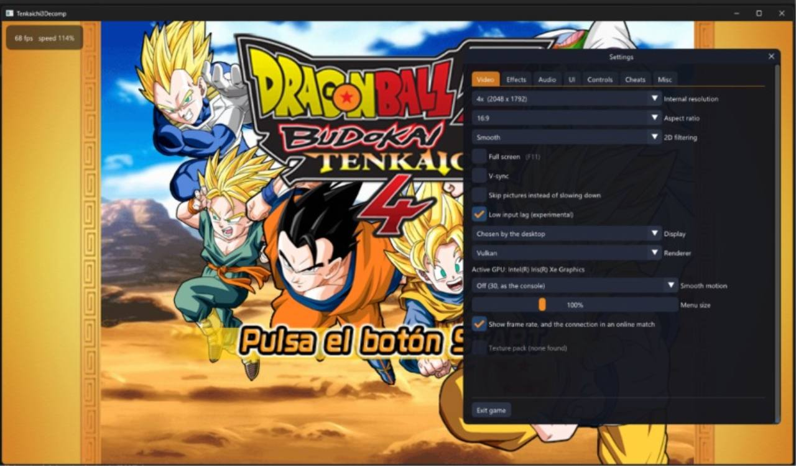

  <h1>DBZ BT4 Tag Team Recomp</h1>
  
Dragon Ball Z: Budokai Tenkaichi 4 on Windows, with battles of up to 5v5.

  
  
<strong>BT4 B14 Rev2 · R24 RC1</strong>

  
<a href="#about-the-mod">About the mod</a> · <a href="#install-or-update">Installation</a> · <a href="#support-and-contact">Donate &amp; contact</a>

## About the mod

BT4 Tag Team Recomp adds simultaneous team battles to BT4 B14 Rev2.
Up to ten fighters can share the arena, with up to five on each team.
Teams can include players and CPU fighters.

You can join online rooms with a code, switch targets during a fight and track
your teammates through the HUD. Voice chat uses proximity: the farther away
another fighter is, the quieter their voice becomes.

The game runs natively on Windows, using the PC port by
[Tenkaichi3Decomp](https://github.com/z3xox/Tenkaichi3Decomp).

  
   <em>A 5v5 match with ally health bars, target selection and radar.</em>

## What's different from BT3?

| | BT3 on PS2 | BT4 Tag Team Recomp |
| --- | --- | --- |
| Team battles | One active fighter per team, with character switching. | Up to five fighters per team fighting at once. |
| Content | Original BT3 roster and game data. | Uses BT4 B14 Rev2 content. |
| Online | No online room system. | Rooms with codes and team selection. |
| Voice chat | None. | Built-in proximity voice. |
| HUD | Shows the two active fighters. | Adds ally information, targets and radar. |
| Platform | PlayStation 2. | Native Windows port with video, audio and control settings. |

  
   <em>Video settings in the PC port.</em>

<!-- bt4-bilingual-install -->
## Game language / Idioma del juego

Choose **Spanish** or **English** in the original startup menu to change text and voices. English is included in the installer: your Spanish BT4 B14 Rev2 installation or ISO is sufficient. No English ISO or additional download is required. Both languages can play online together on R24 RC1.

Elige **Español** o **Inglés** al abrir el juego para cambiar textos y voces. El inglés está incluido: basta tu instalación o ISO española. Abre **`Install.exe`** una vez para añadirlo, sin volver a decompilar.
<!-- /bt4-bilingual-install -->

## Install or update

Download the Windows ZIP from [Releases](https://github.com/NauTaro/tenkaichi3decomp-fork-DBZ-BT4-Decomp/releases). Extract **all contents directly into the game folder**; `Install.exe` sits beside `Tenkaichi3Decomp.exe`.

- **First install:** run `Install.exe` and select your own Spanish BT4 B14 Rev2 ISO. Setup extracts the base game and installs the included English text and voices. An English ISO is also supported if you already own one.
- **Updating:** close the game, copy all ZIP contents over your existing installation and replace files. Preserve `gamedata`, `saves` and `bt3_settings.txt`. Run `Install.exe` once to add the included English language; you do not need to extract your ISO again.

## Development

See [CONTRIBUTING.md](CONTRIBUTING.md) for the source layout, build requirements
and contribution guidelines, or browse the [documentation](docs/README.md).

## Support and contact

Support development through PayPal:

  
   <a href="https://www.paypal.com/paypalme/NauTaro">PayPal: @NauTaro</a>

For questions, feedback or bug reports, message me on Discord or email me:

- **Discord:** `@nautaro`
- **Email:** [mellamannau22@gmail.com](mailto:mellamannau22@gmail.com)

## Credits

The original decompilation and PC port are by the **Tenkaichi3Decomp contributors**.
This mod is based on `v0.1.38.1`; the exact upstream version is recorded in
[UPSTREAM_LOCK.json](UPSTREAM_LOCK.json). See the
[upstream README](README_UPSTREAM.md) and [port documentation](docs/port/README.md).

BT4 content, artwork and icons belong to their respective authors.
See the [media credits](docs/presentation/CREDITS.md), [AGPL](LICENSE),
[MIT](LICENSE-MIT) and the third-party notices included with the libraries.
