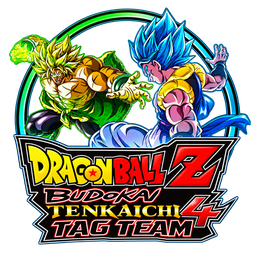

**Español** · [English](README.en.md)

<div align="center">
  
  <h1>DBZ BT4 Tag Team Recomp</h1>
  <p>Mod nativo para Windows basado en Tenkaichi3Decomp.</p>
  <p><strong>En desarrollo · Vista previa R16-rc1</strong></p>
  
</div>

Combates simultáneos por equipos, salas con código, voz por proximidad y un HUD
Tag Team ajustable. Este repositorio contiene el código fuente y la documentación.
El juego original, la ISO, los datos extraídos y las partidas de los jugadores
deben permanecer fuera del repositorio.

## Estado del proyecto

La versión registrada es `BT4-v0.1.38.1-r16-rc1`, para el perfil **BT4 B14 Rev2**.
Consulta la [revisión R16](docs/review/R16-rc1.md) para conocer las pruebas
realizadas y los problemas pendientes. Entre los límites documentados están el
fallo visual de la primera técnica rush de Hit, aún sin resolver, y la cobertura
limitada de equipos, dispositivos y escenarios.

Las descargas disponibles aparecen en [Releases](https://github.com/NauTaro/BT4-Tag-Team-Recomp/releases).
Una release en borrador no es una descarga publicada. Descargar el código fuente
no proporciona una instalación lista para jugar.

## Instalación y actualización

El ZIP completo del lanzador para Windows está preparado para una primera
instalación desde tu propia ISO de **BT4 B14 Rev2** o para una instalación con los
datos ya extraídos. El juego y sus datos no se distribuyen aquí.

1. Obtén un paquete compatible desde Releases cuando esté publicado.
2. Para una primera instalación, utiliza el lanzador con tu propia ISO compatible.
3. Para actualizar, cierra el juego y copia los archivos del programa sobre tu instalación.
   El paquete no incluye `gamedata`, `saves` ni `bt3_settings.txt`, por lo que
   esos datos no se reemplazan.

No necesitas extraer la ISO en cada actualización del código. La extracción es
necesaria para una instalación nueva o un perfil de datos distinto o incompatible.
El [perfil BT4](BT4_PROFILE.md) documenta los datos esperados; su referencia a
0.1.37 describe la base histórica del perfil. La base upstream actual está fijada
en [UPSTREAM_LOCK.json](UPSTREAM_LOCK.json).

La [política de instalación portable](port/release/PORTABLE_LAYOUT.json) define
la estructura de la carpeta del juego. Los informes de pruebas, el código fuente
y los ZIP de distribución se guardan fuera de ella. El verificador permite
revisar esa estructura sin borrar archivos:

```sh
python tools/review/check_portable_layout.py "ruta/a/tu/instalacion"
```

Este comando revisa los nombres y tipos de las entradas de la carpeta principal;
no verifica la integridad de los datos ni garantiza que la instalación esté completa.

## Documentación y desarrollo

| Recurso | Contenido |
| --- | --- |
| [Cómo contribuir](CONTRIBUTING.md) | Preparación, comprobaciones y reportes de errores |
| [Herramientas de revisión](tools/review/README.md) | Requisitos y límites del flujo de compilación local |
| [Documentación del port](docs/port/README.md) | Guías del port heredadas de upstream |
| [Notas de decompilación](docs/README.md) | Sistemas internos del BT3 original y evidencia técnica |
| [Revisión R16](docs/review/R16-rc1.md) | Pruebas registradas y límites de la vista previa |
| [README original](README_UPSTREAM.md) | Documentación y créditos de Tenkaichi3Decomp |

Las comprobaciones ligeras necesitan Python 3.12 y se ejecutan desde la raíz:

```sh
python -m unittest discover -s tools/review/tests -v
```

GitHub Actions ejecuta estas pruebas en Linux y Windows. Comprueban la herramienta
de estructura portable; no compilan el juego ni validan jugabilidad, voz o red.
La compilación completa sigue dependiendo del entorno descrito en las herramientas
de revisión y no se ha verificado desde cero en otros equipos.

## Base, créditos y licencias

Base: [z3xox/Tenkaichi3Decomp](https://github.com/z3xox/Tenkaichi3Decomp),
tag `v0.1.38.1`, commit `11059a6d3e814cf36e6ca1f6307839f61c56f1cc`.
Se conserva el historial de upstream. Este mod es independiente y no es una
publicación oficial de ese proyecto.

Decompilación y port original: colaboradores de Tenkaichi3Decomp. El contenido
BT4, las ilustraciones y el icono conservan los derechos de sus respectivos autores.
Se mantienen las licencias [AGPL](LICENSE), [MIT](LICENSE-MIT) y los avisos de
terceros incluidos con las bibliotecas del runtime y de voz.
